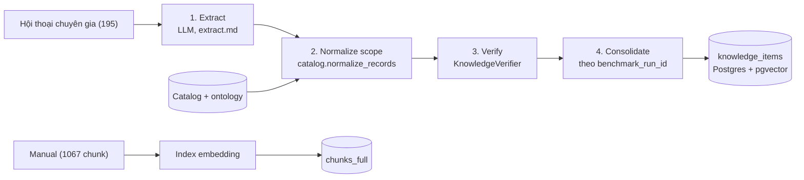
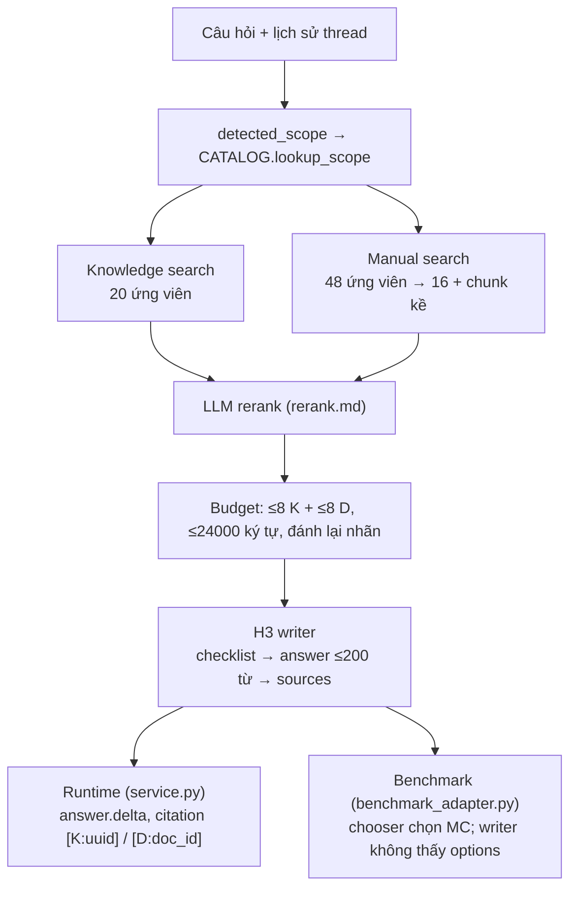

# industrial_qa KB — Thiết kế, flow và benchmark

Cập nhật: 10/10/2026

## 1. Tổng quan

industrial_qa là knowledge base trả lời câu hỏi bảo trì thiết bị công nghiệp. Nó kết hợp hai nguồn tri thức: kinh nghiệm chuyên gia rút ra từ hội thoại, và manual thiết bị. Cùng một pipeline (gọi là H1/H3) được dùng cho API/CLI lúc runtime và cho benchmark, nên điểm đo được phản ánh đúng code chạy thật.

Pipeline có hai pha:

- **Ingest (offline):** LLM trích xuất *case* (sự cố cụ thể) và *lesson* (bài học tổng quát) từ hội thoại, chuẩn hoá phạm vi theo catalog thiết bị, kiểm chứng lại với transcript, gộp trùng, rồi lưu vào Postgres. Manual được chia chunk và index embedding trong cùng database.
- **Trả lời (online):** H1 = truy xuất có giới hạn phạm vi theo asset/family + LLM rerank; H3 = LLM writer lập checklist rồi viết câu trả lời ngắn (≤200 từ) có trích nguồn.

| Thành phần | File chính | Vai trò |
| --- | --- | --- |
| Spec của KB | `__init__.py` | Đăng ký KB, context filter, extraction model, normalizer |
| Catalog thiết bị | `catalog.py`, `catalog_types.yaml`, `catalog_assets.yaml`, `ontology.yaml` | Tên chuẩn của family, asset, component; luật lọc phạm vi |
| Trích xuất | `schema.py`, `extract.md` | Schema case/lesson và prompt trích xuất |
| H1 retrieval | `retrieval.py`, `rerank.md` | Lọc theo phạm vi, tìm kiếm, rerank, cắt theo ngân sách ký tự |
| H3 writer | `answering.py`, `answer.md` | Checklist + câu trả lời + nhãn nguồn |
| Pipeline / service | `pipeline.py`, `service.py` | Ghép H1+H3; stream sự kiện, lịch sử hội thoại, đổi nhãn thành citation |
| Benchmark | `benchmark_adapter.py`, `pilot.py`, `train.py`, `train_report.py`, `rewrite.py`, `snapshot.py` | Chạy, đo và lưu snapshot trên `benchmark/` |

## 2. Dữ liệu đầu vào

KB có ba loại đầu vào. Hệ thống chỉ đọc `benchmark/public/`. File gold chỉ dùng để chọn mẫu và chấm điểm.

| Đầu vào | Nguồn | Quy mô | Trở thành |
| --- | --- | --- | --- |
| Hội thoại chuyên gia ↔ kỹ thuật viên | `conversations.jsonl` (`speakers`, `turns[turn_id, speaker, text]`) | 195 hội thoại, mỗi hội thoại xoay quanh **một asset** | Knowledge records (case + lesson) trong `knowledge_items`, qua LLM extraction |
| Manual thiết bị | `corpus_chunks.jsonl` (`chunk_id`, `doc_id`, `section_path`, trang, `text`) | 1067 chunk: `fx5_comm` 846, `omron_i4l` 114, `melservo_je` 107 | Document chunks (embedding + từ khoá), không qua LLM |
| Catalog thiết bị | `catalog_types.yaml` (viết tay) + `catalog_assets.yaml` (sinh bằng `catalog build`) | 3 family, 195 asset, các line/site/component | Bộ lọc scope lúc ingest và lúc truy hồi |
| Ontology | `ontology.yaml` | `failure_mode` đóng, 12 giá trị | Chuẩn hoá trường `failure_mode` |

**Ba family thiết bị** (catalog_types.yaml):

| Family | Loại | Manual | Tiền tố asset ID |
| --- | --- | --- | --- |
| FX5 | PLC | `fx5_comm` | `FX5-PLC…` |
| MR-JE | Servo amplifier | `melservo_je` | `MR-JE-AX…` |
| i4L | SCARA robot | `omron_i4l` | `i4L-R…` |

Catalog cho phép suy ra family từ asset ID, alias ("SCARA", "servo amp"…), tên component (component luôn thuộc một family) hoặc biến thể model. Từ family suy ra manual đúng. Đây là trục chính để lọc nhiễu giữa ba nhóm thiết bị.

**Knowledge record** (schema `industrial-qa-case-lesson-v3`) có hai loại:

- **Case**: một sự cố cụ thể. `subject` cộng `case_card` gồm context, observation, reasoning, action, outcome và các evidence quote có `turn_id`.
- **Lesson**: một kinh nghiệm có thể tái dùng. `claim`, `steps`, `mandatory`, `source_turns` và `case_refs` trỏ tới các case làm bằng chứng.

Cả hai mang `context` (scope): `machine_id`, `machine_model`, `machine_model_specific`, `component_id`, `component_model`, `line_id`, `station`, `product_model`, `configuration`, `serial_range`, `condition`, `failure_mode`. Ba trường đầu được index để lọc (`include_unscoped=False`). Các trường còn lại chỉ được hiển thị cho writer.

## 3. Flow ingest

*Hội thoại đi qua 4 bước LLM/rule; manual chỉ được index.*

Hai nhánh chạy độc lập. Chỉ hội thoại đi qua LLM; manual được index nguyên chunk.

1. **Extract** (`EXTRACTION_MODEL`, prompt `extract.md`, output theo `schema.py`). Mỗi hội thoại cho ra các **case** (sự cố cụ thể kèm case_card và quote theo `turn_id`) và các **lesson** (kinh nghiệm tái dùng, trỏ về case qua `case_refs`).
2. **Normalize**. `catalog.normalize_records` đưa scope về ID chuẩn: asset ID → `machine_id`, family → `machine_model`, biến thể → `machine_model_specific`, cùng line/component. `ontology.yaml` ép `failure_mode` về 12 giá trị đóng. Mọi thay đổi được ghi vào `record.revision` để review.
3. **Verify** (`KnowledgeVerifier`). Kiểm tra record có được transcript chống đỡ hay không.
4. **Consolidate**. Gộp hoặc link với record trùng. Phạm vi bị khoá trong `benchmark_run_id` của run, nên một run không sửa record của run khác.

**Vận hành.**

- `pilot.py ingest` xử lý một mẫu. `train.py` tái dùng record của run baseline và chỉ extract các hội thoại còn thiếu, dưới một run ID mới; retrieval đọc hợp của hai run.
- `pilot.py renormalize` áp catalog/ontology mới lên record cũ mà không extract lại.
- `snapshot.py` (xem `SNAPSHOT.md`) export/import riêng bảng `knowledge_items`, phần đắt để tái tạo. Manual, hội thoại thô và embedding được dựng lại từ `benchmark/public/`.

## 4. Flow trả lời: H1 retrieval → H3 writer

*H1 (retrieval) → H3 (writer), dùng chung cho runtime và benchmark.*

Runtime (`service.py`) và benchmark (`benchmark_adapter.py`) gọi **cùng một** `IndustrialRetriever` và `IndustrialAnswerWriter` (qua `pipeline.py`). Hai bên chỉ khác ở đầu vào và đầu ra. Vì vậy số đo benchmark phản ánh đúng logic production.

**H1: chọn bằng chứng** (`retrieval.py`, `RetrievalConfig`)

- **Scope trước, ngữ nghĩa sau.** Asset ID hoặc family nhận ra từ câu hỏi thành filter cứng trên `machine_id` / `machine_model` / `machine_model_specific`. Nhờ đó kinh nghiệm của máy khác không lọt vào. Nếu phát hiện nhiều hơn một family thì không lọc theo family.
- **Hai nguồn chạy song song.** Knowledge records (20 ứng viên) và manual chunks (48 ứng viên). Query cho manual bỏ các chi tiết cục bộ của nhà máy (asset ID, site, line, cell) và thêm tên family, vì manual không biết các tên đó.
- **Chống một hội thoại chiếm hết chỗ.** Khi câu hỏi không nêu asset, mỗi hội thoại đóng góp tối đa 3 record. Khi có asset nhưng không tìm thấy gì, hệ thống mở rộng sang record không gắn máy hoặc cùng family.
- **Thủ tục không bị cắt giữa chừng.** Chunk nằm trong top 3 có dạng procedure/steps/connect/configure được bổ sung các chunk kề cùng section, cách không quá 2 trang.
- **Rerank bằng LLM rồi cắt theo budget.** Một lần gọi LLM xếp hạng toàn bộ ứng viên. Sau đó lấy lần lượt theo thứ hạng cho đến khi hết 8 slot mỗi loại hoặc hết 24 000 ký tự. Record được render gọn thành `[K1] case|lesson: subject {scope}` + claim, không kèm case_card/quote. Passage được render thành `[D1] manual <doc_id>, p. N, <section>` + text.

**H3: viết câu trả lời** (`answering.py`, `answer.md`)

- Một lần gọi `ANSWER_MODEL` với JSON schema. Thứ tự field là thứ tự sinh: **checklist** (tối đa 8 điểm bắt buộc, mỗi điểm kèm nhãn nguồn) → **answer** (viết cho tai nghe, tối đa khoảng 200 từ, không list/heading, nêu đủ mọi điểm của checklist) → **sources**. Checklist đóng vai trò kế hoạch nên answer ít bị sót ý.
- Các quy tắc trung thực: kết hợp thực hành của chuyên gia với ý nghĩa/remedy trong manual; không biến đề xuất thành việc đã làm; không tự dựng thứ tự cho các bước có điều kiện; nói rõ khi thiếu bằng chứng; không điền từ trí nhớ.
- `ANSWER_THINKING` phải là `disabled`. Nếu bật thinking, câu trả lời có thể cạn `max_tokens=8192`.

**Đầu ra.**

- **Runtime:** `service.py` giữ lịch sử thread (5 lượt gần nhất, tối đa 6000 ký tự; chỉ để hiểu tham chiếu, không phải bằng chứng). Service phát các event `run.started` → `tool.started/completed` → `answer.delta` → `answer.citations` → `run.completed`, và đổi nhãn thành citation `[K:<uuid>]` / `[D:<doc_id>]`.
- **Benchmark:** writer không bao giờ thấy options. Một *chooser* riêng (`max_tokens=1024`) đọc answer đã viết và chọn A–D, nên MC accuracy đo khả năng hiểu của answer chứ không phải đoán theo options. `ScopedRetrieval` thêm filter `benchmark_run_id` để mỗi run chỉ đọc record của chính nó (cộng các run baseline được tái dùng).

## 5. Benchmark

**Bộ dữ liệu** (`benchmark/`). 500 câu hỏi được sinh từ bằng chứng đã biết. Mỗi câu có reference answer, danh sách key point, phiếu MC 4 lựa chọn và gold evidence (turn hội thoại và/hoặc chunk manual). Hai split chia theo hội thoại nên không trùng nhau.

| knowledge_source | Ý nghĩa | Train (100 câu / 38 hội thoại) | Test (400 câu / 155 hội thoại) |
| --- | --- | --- | --- |
| `expert_only` | Đáp án chỉ có trong hội thoại chuyên gia | 43 | 157 |
| `docs_only` | Đáp án chỉ có trong manual | 26 | 124 |
| `expert_and_docs` | Cần ghép kinh nghiệm chuyên gia với manual | 31 | 119 |

Về độ khó: **easy** là một sự kiện nói gần như thẳng. **medium** mô tả triệu chứng bằng lời khác và cần nối triệu chứng với hành động/nguyên nhân. **hard** cần hai mẩu bằng chứng trở lên. Hội thoại cũng có nhiều kiểu khó: direct, implicit, correction_reference (chuyên gia sửa ý sai rồi nhắc lại sau), noisy.

**Luật công bằng.** Hệ thống chỉ đọc `benchmark/public/`. Gold chỉ dùng để chọn mẫu và chấm. Writer không thấy options.

**Metric** (`benchmark/evaluate.py`, `benchmark/metrics.py`, cộng phần bổ sung trong `pilot.py`)

| Metric | Đo gì |
| --- | --- |
| `recall@k`, `context_precision@k` | Gold evidence có nằm trong top-k nguồn đã xếp hạng không, và được xếp sớm không. Nguồn được writer cite đứng trước theo thứ tự cite. Record được quy về các turn nó trỏ tới. |
| `mc_accuracy` | Chooser chọn đúng đáp án từ answer đã viết (so khớp, không dùng LLM). |
| `answer_score` | LLM judge chấm từng key point: covered 1 / partial 0.5 / missing / contradicted; lấy trung bình. |
| **`answer_correct`** | **Metric chính**: score ≥ 0.8 và không có mâu thuẫn với reference. |
| `record_recall`, `extraction_turn_coverage` | Gold expert fact có được record nào trỏ tới không, tức chất lượng extraction. |
| `ingestion_quality` | Tỉ lệ verify, thay đổi scope/catalog, chồng lấn case/lesson, lỗi consolidate. |

Judge là `MODELARK_*`, nếu không có thì dùng `EXTRACTION_*` / `OPENROUTER_*`. Hiện judge là `deepseek-v4.1-flash`, **cùng model với answer model**.

**Công cụ chạy.** Mỗi bước đều resume được từ `run.json`; kết quả nằm trong `data/industrial_qa_runs/<run>/`.

| Lệnh | Dùng khi |
| --- | --- |
| `pilot.py all` (select → ingest → answer → evaluate) | Chạy nhanh trên một mẫu nhỏ câu hỏi train, rải đều các ô source × difficulty |
| `pilot.py renormalize` | Chỉ đo tác động của catalog/ontology mới |
| `train.py all` | Đánh giá đầy đủ 100 câu train, tái dùng record baseline |
| `rewrite.py` | Giữ nguyên nguồn H1 của một run cũ và chỉ viết lại bằng H3 hiện tại. Đo thay đổi writer mà không chịu nhiễu của reranker; chỉ chấm answer |
| `train_report.py` | Báo cáo từ artifact của một run, không gọi API |

`manifest.json` của mỗi run ghi model và sha256 của các file prompt/code. Nếu writer đã đổi thì không resume vào run dir cũ được.

## 6. Kết quả hiện tại (train split, 100 câu)

**Ingest** (run baseline, 38 hội thoại):

- 240 record: 39 case, 97 heuristic, 80 rule, 24 procedure.
- 100% record qua verify; 228/240 có `machine_id`; 0 lỗi consolidate.
- Record trỏ tới 146/148 gold expert fact.
- Với câu `expert_only`, record recall@5 = 0.95.

Extraction không phải điểm nghẽn.

**Trả lời.** Các run writer dùng `rewrite.py`, tức giữ cùng nguồn H1 với baseline. `answer_correct` theo từng nhóm nguồn:

| Run | answer_correct | answer_score | expert_only | docs_only | expert_and_docs | Số từ (median) | > 200 từ |
| --- | --- | --- | --- | --- | --- | --- | --- |
| Baseline (writer cũ) | 0.84 | 0.943 | 0.84 | 0.92 | 0.77 | 125 | 3 |
| Writer checklist dài (+ quote) | 0.90 | 0.975 | 0.88 | 1.00 | 0.84 | 428 | 94 |
| Writer ngắn + quote, lần 1 | 0.87 | 0.955 | 0.93 | 0.96 | 0.71 | 179 | 21 |
| Writer ngắn + quote, lần 2 | 0.89 | 0.966 | 0.88 | 1.00 | 0.81 | 184 | 23 |
| **Writer ngắn, không quote, lần 1 (chính thức)** | **0.86** | 0.957 | 0.86 | 0.96 | 0.77 | 173 | 16 |
| **Writer ngắn, không quote, lần 2 (chính thức)** | **0.87** | 0.956 | 0.88 | 0.96 | 0.77 | 176 | 25 |

Các số khác gần như không đổi giữa các run: `mc_accuracy` 0.98–1.00; `recall@5` khoảng 0.87–0.90, giảm nhẹ khi writer cite ít nguồn hơn vì nguồn được cite xếp trước.

**Đọc số này thế nào.**

- **Nhiễu lớn so với mức chênh.** Chấm lại cùng bộ answer làm lật 1–2/100 câu. Chạy lại cùng writer làm lật 7–10/100 câu, vì provider không tất định dù temperature 0. Trên n = 100, chênh lệch dưới khoảng 5 điểm giữa hai lần chạy đơn lẻ không có ý nghĩa.
- **Writer ngắn giữ phần lớn mức tăng.** Trung bình hai lần chạy khoảng 0.865, so với 0.84 của baseline (chỉ đo một lần). Độ dài chỉ bằng khoảng 40% bản dài, phù hợp cho voice.
- **Quote trong source text** không cho lợi ích đo được (0.87/0.89 so với 0.86/0.87, nằm trong nhiễu) nên đã bỏ để prompt gọn hơn.
- **`expert_and_docs` vẫn yếu nhất** (khoảng 0.77). Một phần lỗi là lỗi thật: writer bỏ bước thủ tục trong manual khi đã có thao tác của chuyên gia, ví dụ q_0054. Một phần do chính benchmark: có cặp câu hỏi gần giống nhau nhưng reference mâu thuẫn nhau (q_0057/q_0058, q_0203/q_0204).

## 7. Review solution chính thức

**Trạng thái code (10/10/2026).**

- Writer ngắn, không quote, đã nằm trong commit `5611197`.
- Đang sửa dở, chưa commit:
  - Chính sách một database (`runs.py`): mỗi lần ingest mới sẽ thay corpus trong `kb_industrial_qa`, và có lock để các tiến trình ghi không chạy song song.
  - Snapshot `knowledge_items` lên Hugging Face (`snapshot.py`, `SNAPSHOT.md`, `HF_*` trong `.env.example`).
  - `rewrite.py`/`train.py` được chỉnh theo hai thay đổi trên.
- Test: các bộ `test_industrial_qa*` đều pass. Còn 6 test cũ lỗi vì vẫn gọi KB `enterprise_rag`/`assetopsbench`, hai KB đã bị gỡ.

**Điểm tốt của thiết kế**

- Runtime và benchmark dùng chung H1/H3, nên số đo benchmark là số của production.
- Scope được xác định trước bằng catalog, nên kinh nghiệm của máy khác và manual của family khác bị chặn từ gốc.
- Writer không thấy options, nên MC accuracy không bị thổi phồng.
- Có thể tái lập: mỗi run có manifest kèm sha của prompt/code, resume theo từng bước, và `rewrite.py` cho phép tách riêng hiệu ứng của writer khỏi nhiễu của retrieval.

**Rủi ro và lỗ hổng**, sắp theo mức độ quan trọng:

1. **Đánh giá còn lạc quan.**
   - Mới đo trên train: n = 100 và đã dùng để tinh chỉnh prompt.
   - Judge là cùng model với answer model.
   - Baseline chỉ đo một lần.
   - Test split 400 câu chưa chạy.
2. **`ANSWER_THINKING` chưa được ghim.** `.env.example` để trống. Nếu provider mặc định bật thinking, writer có thể cạn 8192 token và trả lỗi. Nên đặt mặc định `disabled`.
3. **Giới hạn 200 từ chỉ là mềm.** 16–25/100 câu trả lời vượt quá. Với voice, cần quyết định chấp nhận hay cắt cứng/tóm lại.
4. **`expert_and_docs` (khoảng 0.77) là lỗ hổng chất lượng lớn nhất.** Writer hay bỏ bước trong manual khi đã có thao tác của chuyên gia.
5. **Phụ thuộc vào catalog đóng.**
   - Chỉ có 3 family. `catalog_assets.yaml` được sinh từ chính các hội thoại benchmark.
   - Máy mới phải chạy lại `catalog build` / `renormalize`.
   - Câu hỏi nhắc nhiều family sẽ không được lọc theo family.
6. **Một database cho mọi run.** Ingest mới ghi đè corpus, nên `rewrite.py` trên run cũ chỉ chạy được sau khi restore snapshot (nay đã có check báo lỗi rõ).
7. **Nợ kỹ thuật nhỏ.**
   - `rewrite.py` gán `pilot.SPEC = SPEC`, tức sửa biến global của module khác.
   - `train.py` còn nhánh đặt tên `experiment_*` cho thư mục `experiments/` không còn tồn tại.
   - Thiếu unit test cho `render_record`.
   - Còn tham chiếu cũ tới `enterprise_rag`/`assetopsbench` trong `test_knowledge_bases.py`, `test_script_entrypoints.py`, `test_assetopsbench.py`, `test_enterprise_rag.py`, `scripts/kb.py`, `knowledge_bases/README.md`.
8. **Chưa đo latency/chi phí.** Mỗi câu tốn hai lần gọi LLM nối tiếp (rerank, rồi writer), cộng embedding search. Điều này quan trọng với voice agent.

**Bước tiếp theo đề xuất**

1. Ghim `ANSWER_THINKING=disabled`; dọn các test và tham chiếu cũ để test suite xanh.
2. Commit phần single-DB và snapshot, rồi snapshot corpus train hiện tại để các run sau tái lập được.
3. Đóng băng thiết kế, chạy test split một lần (400 câu) với judge khác model answer. Mỗi cấu hình chạy ít nhất 2 lần.
4. Sau đó mới tối ưu tiếp `expert_and_docs` và đo latency end-to-end.
